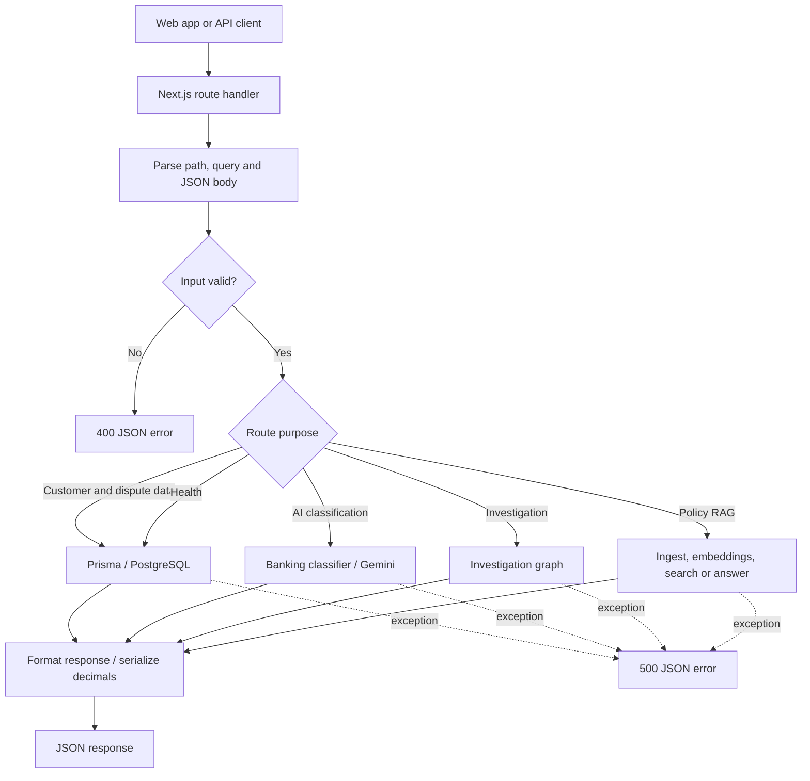

# BankAssist API guide

This guide covers the Next.js API route handlers in `apps/api/app/api`. In the App Router, the exported HTTP method (`GET`, `POST`, `PATCH`) is the endpoint function. Most routes use Prisma for PostgreSQL access; routes that accept structured input validate it with Zod. Error responses are returned as JSON with an appropriate HTTP status.

## Request flow

## Routes and method notes

### Admin customers — `app/api/admin/customers/route.ts`

- `POST /api/admin/customers` — validates customer and first-account fields, creates both records together, returns `201`; reports duplicate email/mobile/account number as `409`.
- `GET /api/admin/customers?search=&page=&pageSize=` — searches customer name/email/mobile/account number, returns customers and accounts with pagination; page size is capped at 50.

### Customer profile and activity

- `GET /api/customers/:customerId` (`app/api/customers/[customerId]/route.ts`) — fetches profile and account summaries; decimal balances are converted to strings.
- `GET /api/customers/:customerId/transactions` (`.../transactions/route.ts`) — loads every account and its transactions, newest first, then flattens them with account numbers.
- `GET /api/customers/:customerId/transactions/:reference` (`.../transactions/[reference]/route.ts`) — currently loads and returns **all** transactions for the customer, along with account summaries; it does not filter by the `reference` path segment.
- `POST /api/customers/:customerId/investigations` (`.../investigations/route.ts`) — validates the customer and query, extracts an optional `TXN...` reference from the text, invokes the investigation graph, validates its structured result, and returns that plus a policy answer when available.

### Customer disputes — `app/api/customers/[customerId]/disputes/route.ts`

- `POST /api/customers/:customerId/disputes` — validates reason, description, customer confirmation and one or more transaction references; verifies customer ownership, debit type, and no existing dispute; creates one dispute linked to the selected transactions.
- `GET /api/customers/:customerId/disputes` — returns the customer's disputes and linked transactions, newest first; includes legacy single-transaction response fields for older clients.
- `generateDisputeReference()` — makes a reference in `DSP-YYYYMMDD-XXXXXX` form using the current UTC date and random hex suffix.

### Support dispute queue and details

- `GET /api/support/disputes?status=&search=&page=&pageSize=` (`app/api/support/disputes/route.ts`) — validates filters, searches reference/customer/transaction, and returns a paginated queue with linked transactions and audit count.
- `GET /api/support/disputes/:disputeId` (`.../[disputeId]/route.ts`) — returns dispute, customer, transactions and chronological audit history.
- `PATCH /api/support/disputes/:disputeId/status` (`.../[disputeId]/status/route.ts`) — validates status/actor/note, enforces `OPEN → UNDER_REVIEW → RESOLVED|REJECTED`, and atomically updates status plus audit log. Invalid/concurrent transitions return `409`.
- `POST /api/support/disputes/:disputeId/notes` (`.../[disputeId]/notes/route.ts`) — adds a support-agent audit note while the dispute is `UNDER_REVIEW`; otherwise returns `409`.
- `POST /api/support/disputes/:disputeId/investigate` (`.../[disputeId]/investigate/route.ts`) — checks review status, linked transactions and ownership; runs the investigation graph, validates and saves a versioned report and optional policy answer.
- `GET /api/support/disputes/:disputeId/investigate` — returns the latest saved investigation report and policy answer, or `null` when none exists.

### AI and policy routes

- `POST /api/ai/classify` (`app/api/ai/classify/route.ts`) — validates a banking message and calls `classifyBankingQuery`; returns its result or a `500` error.
- `POST /api/ai/investigation` (`app/api/ai/investigation/route.ts`) — passes customer ID, message and optional transaction reference to the investigation graph and returns graph output. This lightweight route does not perform the stronger request/result validation used by the customer investigation route.
- `POST /api/rag/ingest` — loads and indexes policy documents; response success reflects whether any documents failed.
- `POST /api/rag/embeddings` — accepts non-empty text and returns preview values for document and query embeddings.
- `POST /api/rag/search` — validates query and optional `topK` (default 3), then returns matching policy chunks.
- `POST /api/rag/answer` — validates a policy question and returns an answer produced by the policy RAG pipeline.

### Health

- `GET /api/health/db` — runs `SELECT 1`; returns connected status or `500` with disconnected status.

## Duplicate route files

There are also `src/app/api/ai/classify/route.ts` and `src/app/api/health/db/route.ts`. They duplicate the corresponding routes under `app/api`. The Next.js project uses `app/` at the project root (see `app/page.tsx`), so those `src/app` copies are not the route implementations described above. The `src` copies contain a separate direct Gemini classifier and duplicate database health check.

- Duplicate `POST /api/ai/classify` — validates a message, invokes Gemini with a structured response schema directly, and returns category, intent, confidence and investigation requirement.
- Duplicate `GET /api/health/db` — performs the same database connectivity check as the root `app/api` handler.

## Shared downstream code

The API handlers delegate business logic to `src/lib`: `db/prisma.ts` provides the Prisma client; `ai/classifier.ts` and `ai/gemini.ts` implement classification/model access; `agents/investigation.graph.ts` coordinates investigations; and `rag/*` implements policy loading, embeddings, retrieval and answering. The graph and RAG route handlers therefore start in `app/api`, then hand off to these modules before returning JSON.
